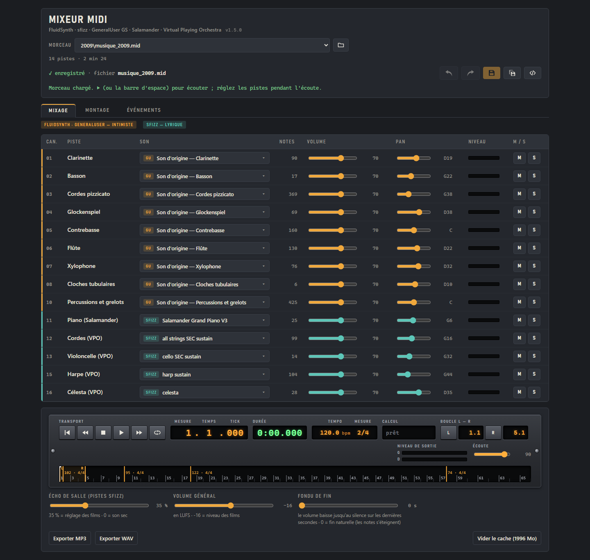
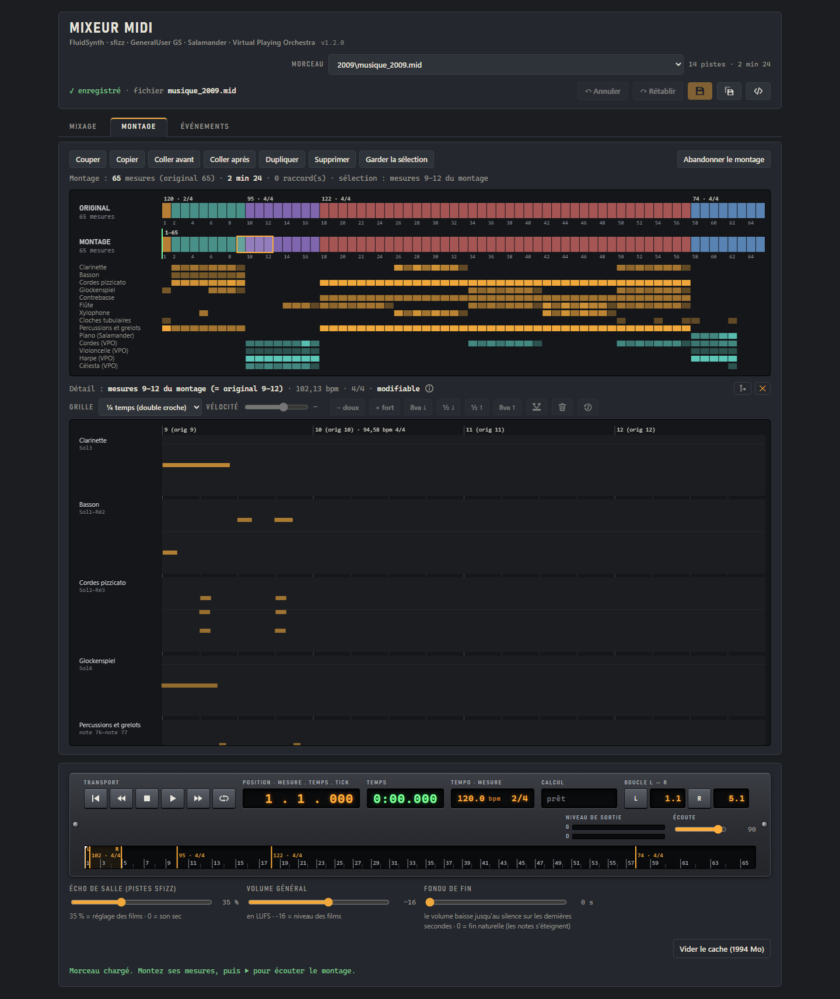
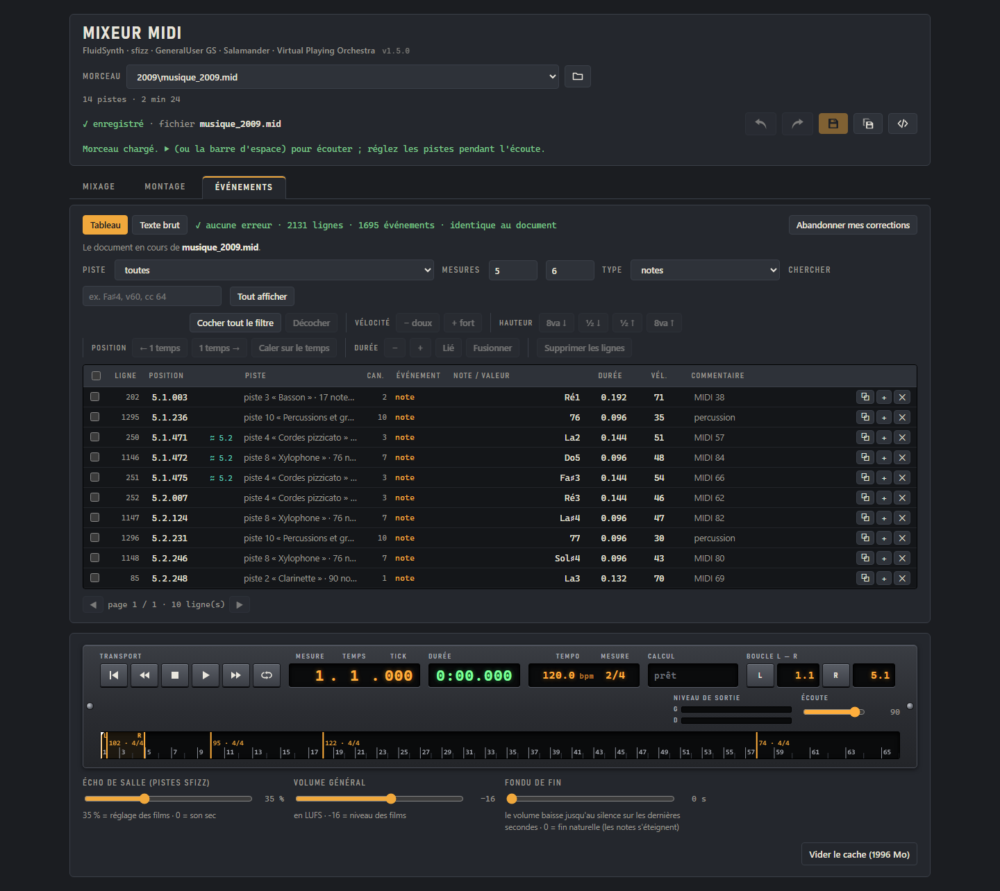

# Mixeur MIDI

[Lire en français](README.fr.md)

A **local** mixing console for `.mid` files: choose the sound of each track from two engines, adjust the mix while listening, rearrange bars, edit notes, then export to MP3 or WAV.

- **FluidSynth + GeneralUser GS**: an "intimate" sound, General MIDI instruments (piano, guitars, drum kits…)
- **sfizz + Salamander Grand Piano + Virtual Playing Orchestra**: a "lyrical" sound, real piano and orchestra

The application runs on your PC (`http://localhost:8765`, reachable only from this machine) and is used in the web browser. Nothing is sent over the Internet, and the server only obeys its own console: requests coming from any other website open in the browser are refused.

The interface is in French; the tab and button names below are given as they appear on screen.

## Overview



***Mixage** (mixing) tab: each track chooses its sound (GeneralUser or sfizz), its volume and its pan; the transport bar plays the mix.*

## Features

**Mixage (mixing)**
- Per track: sound (search across both engines, in French or English), volume, pan, mute / solo, level meter
- Room reverb, overall loudness in LUFS, fade-out at the end
- The mix updates while you listen; each rendered track is kept in a cache
- Normalized MP3 / WAV export, saved next to the piece

**Montage (arranging)**
- Whole bars: cut, copy, paste, duplicate, move, with clean joins
- Piano roll of the selected bars: move, lengthen, add, delete and transpose notes
- Loop over the selected bars; the detail view follows playback



**Événements (events)**
- Every MIDI event in a table you can filter and edit, or as commented text
- Batch actions: velocity, transposition, shift, duration, tied notes, snapping to the beat



**Working document**
- All three tabs work on the same document, with Undo / Redo and versions
- "Enregistrer" (save) replaces the open file (its previous version is kept in a `sauvegardes` folder next to the piece); "Enregistrer une copie" (save a copy) creates `_v2`, `_v3`…; settings alone go to a `.mix.json` file

## Installation (Windows)

1. **Python 3.12** or later, then the MIDI library and the level-meter computation:
   ```
   pip install mido numpy
   ```
2. **Engines and tools**:
   - [FluidSynth](https://www.fluidsynth.org) (`fluidsynth.exe`)
   - [sfizz](https://sfz.tools/sfizz/) (`sfizz_render.exe`)
   - [ffmpeg](https://ffmpeg.org) (on the PATH, or with its full path in the configuration)
3. **Sound banks**:
   - [GeneralUser GS](https://www.schristiancollins.com/generaluser.php) (`GeneralUser-GS.sf2`)
   - a folder of SFZ banks containing [Salamander Grand Piano](https://github.com/sfzinstruments/SalamanderGrandPiano) (`SalamanderGrandPiano-master`) and [Virtual Playing Orchestra 3](http://virtualplaying.com/virtual-playing-orchestra/) (`VPO/Virtual-Playing-Orchestra3`)
4. **Configuration**: copy `config.exemple.json` to `config.json`, then fill in:
   - `racines`: the folders in which to look for `.mid` pieces
   - `fluidsynth`, `generaluser`, `sfizz_render`, `dossier_sfz`, `ffmpeg`: the paths of the tools and banks

   `config.json` is specific to each PC and is not versioned.

## Starting

```
pythonw -I mixeur.py
```

The console opens in the web browser. For a desktop shortcut, target `pythonw.exe` with the arguments `-I "<folder>\mixeur.py"` and the icon `page\favicon.ico`.

**To stop it**, close the tab: the mixer stops by itself about ten seconds after the last tab is closed.

## Command-line tool

`midi_texte.py` can also be used on its own to read and edit a `.mid` file in a text editor:

```
python midi_texte.py piece.mid          → piece.mid.txt
python midi_texte.py piece.mid.txt      → piece_texte.mid
```

The round trip is exact, and no file is ever overwritten.

## Files

| File | Role |
|---|---|
| `mixeur.py` | server, track rendering, mixing, export |
| `montage.py` | splitting into bars, assembling the arrangement, joins |
| `travail.py` | working documents: versions, saving, automatic names |
| `midi_texte.py` | `.mid` ⇄ commented text conversion |
| `retouches.py` | edits made to a piece generated by a script: carrying them over into the script itself (the old one kept in "sauvegardes") |
| `page/` | the console (HTML, CSS, JavaScript); `page/icones/`: the button icons, one SVG file each |
| `docs/` | screenshots of the console, for this README |
| `config.exemple.json` | template for `config.json` |
| `VERSION.txt` | the application's version number |
| `LISEZMOI.txt` | detailed user guide, tab by tab (in French) |
| `cache/` | rendered tracks and work in progress (created at startup, capped at 2 GB, not versioned) |

## Versions

`MAJOR.MINOR.PATCH` numbering in `VERSION.txt`, shown at the top of the console. Each version is marked by a Git tag (`v1.0.0`, `v1.1.0`…). If the running mixer was started before an update, the console asks you to restart it.

## Coming next

Volume automation, sound preview, transposition and tempo, replacing a film's soundtrack; later, a portable `.exe` version.
